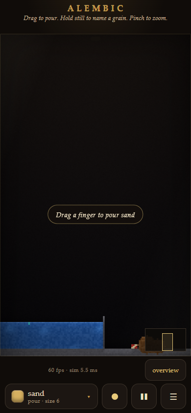
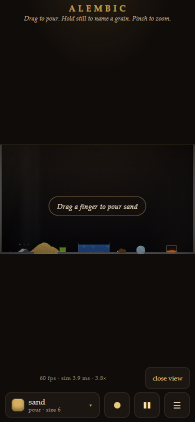

# Thermal work and portrait framing

The thermal pass skips source and buoyancy scans in homogeneous chunks at
resting heat when their surrounding chunks are also quiet and unchanged.
Dense fields keep a contiguous source scan. Heat copies combine adjacent
active chunks into runs; fully active fields use one bulk copy.

Portrait phones now use the available vessel height for a close view around
the pond and casks. A visible overview button fits the entire 480×270 world.
Camera geometry is shared by rendering, painting, probing, pinch/pan, minimap,
and resize handling. Both WebGL quality settings preserve the viewport's
backing-buffer aspect, and the 2D fallback uses the same camera transform.
Flask feedback sits inside the vessel so saved-state messages do not overlap
the phone heading.

World dimensions, material IDs, simulation order, random streams, and checkpoint
format are unchanged. No runtime dependency or v2 build step was added.

## Performance

Baseline: `b11c88d63092e6cdf9a19deffa367cff5bcd3e8e` (current main on October 12).
The baseline checkout had an identical source tree. Windows x64, Node 22.19.0,
V8 12.4.254.21. Five interleaved A/B rounds alternate execution order, each with
120 warmup and 600 measured ticks per scene. Results are the median of each
round's median step time. Browser tests and other verification were stopped
during timing. This host has roughly 4% noise; the acceptance gate allows no
scene to regress by more than 10%.

| Scene | Main median step | Candidate median step | Change |
| --- | ---: | ---: | ---: |
| Settled | 2.047 ms | 1.424 ms | 30.4% less |
| Falling | 3.198 ms | 2.757 ms | 13.8% less |
| Wet | 3.526 ms | 2.995 ms | 15.1% less |
| Storm | 8.930 ms | 8.359 ms | 6.4% less |

Every scene passed the 10% regression gate. Improvements are host measurements,
with the storm result closest to the host's noise range.

Raw results: [five-round benchmark](evidence/2026-10-12-bench.json).
These measure simulation CPU work, excluding rendering and worker transport.
They do not establish physical-phone battery life or frame time.

## Correctness

- `npm run test:v2`: 182 passed, including 10 new thermal/camera tests.
- `npm test`: 168 passed. Existing tests were not modified.
- `npm run lint`, `npm run typecheck`, and
  `npm run build -- --base=/falling-sand/`: passed. The existing v1 bundle-size
  advisory remains.
- JavaScript syntax checks and `git diff --check`: passed.
- [Exact-state comparison](evidence/2026-10-12-verify.json): 16 cases passed
  against main. Settled, falling, wet, storm, and opening-vessel scenes each ran
  720 ticks with three seeds, comparing every 120 ticks. An additional edit,
  heat/cool, blast, legacy load, and wipe sequence compared all 240 ticks.
  Hashes include every authoritative field, exact typed-array bytes, random
  states, and queues. Quiet-cache scratch and diagnostics are not saved state.
- Read-only code review found a portrait render-buffer aspect issue, which was
  fixed and tested. No actionable findings remained after review.

Reproduce from PowerShell, with a clean baseline checkout outside the candidate:

```powershell
git worktree add --detach ../alembic-main-baseline b11c88d63092e6cdf9a19deffa367cff5bcd3e8e
node scripts/verify-ab-v2.mjs ../alembic-main-baseline .
node scripts/bench-ab-v2.mjs ../alembic-main-baseline . 5
```

## Browser acceptance

Fresh headless Chromium contexts used the local Vite page at
`http://127.0.0.1:5180/v2/index.html`. Start it from PowerShell with
`npx vite --host 127.0.0.1 --port 5180 --strictPort`.

- Portrait 390×844: vessel viewport 390×659, compared with 390×219 on main.
  The close preset makes grains about 3.75 times larger in each dimension.
  Overview returns to the full 16:9 vessel, and close view restores the preset.
- Landscape 844×390: 679×382 vessel and side controls.
- Desktop 1440×900: 1160×653 vessel; mouse-wheel zoom and F-to-fit work.
  Saved-flask feedback remains visible above the canvas without capturing input.
- Forced 2D fallback and grain-quality rendering: portrait framing and overview
  work with square pixels. Full-quality DPR 1 and 2 were checked.
- Touch painting and a 450 ms hold identified the expected stone cell. Actual
  multi-touch pinch changed the camera without painting. Pausing held the
  simulation clock. Saving and restoring a complete flask recovered the prior
  cells and tick. Rotation, immersive fullscreen entry/exit, and page overflow
  checks passed in WebGL and the 2D fallback at DPR 2 with reduced motion.
- No page exceptions were observed.

Raw smoke results: [layouts and renderers](evidence/2026-10-12-browser.json),
[touch and saved-flask flows](evidence/2026-10-12-interactions.json).

The close-view, overview, landscape, desktop, and fallback screenshots were
visually inspected. Phone coverage is emulation; no physical iPhone or Android
device was available. Browser HUD timings are smoke-test observations, not the
benchmark above.




