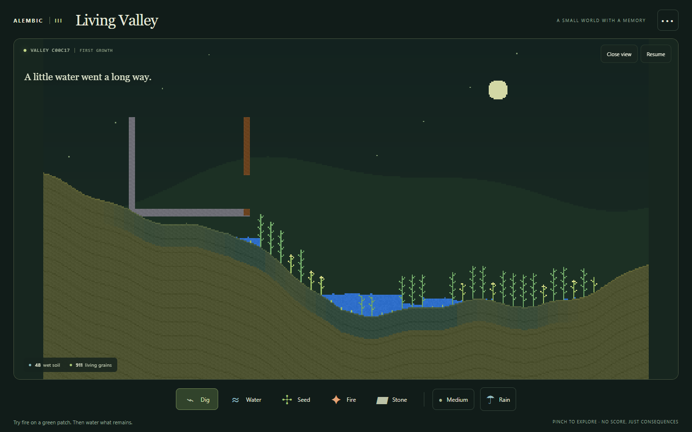
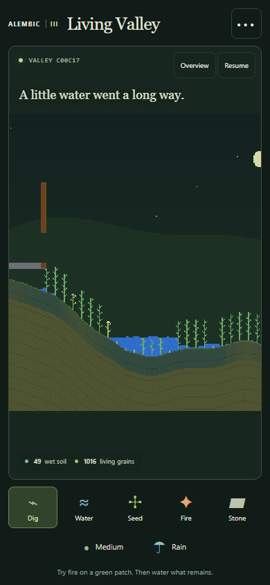
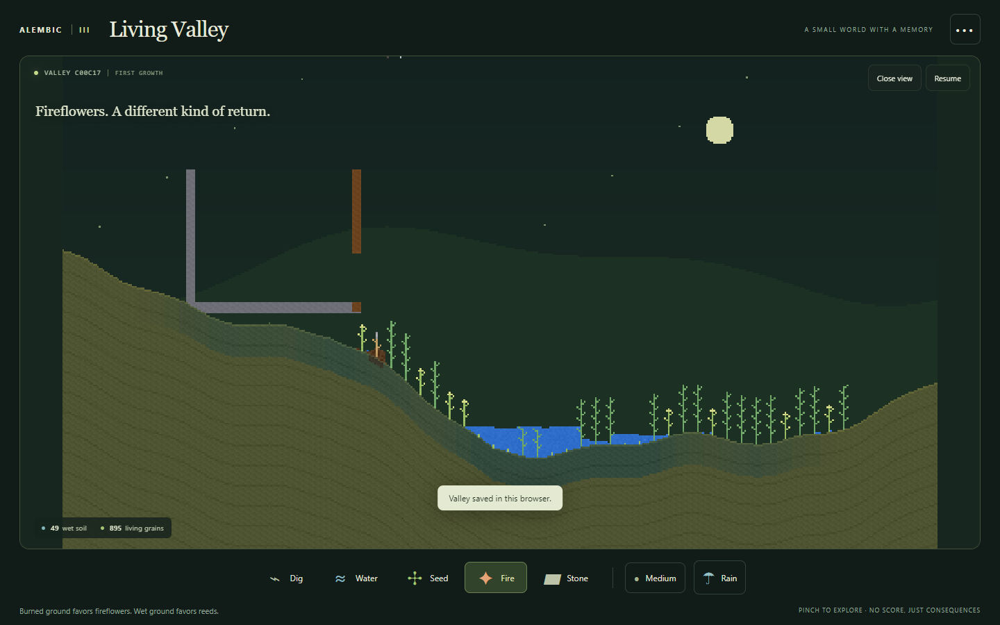

# Living Valley: implementation and verification

The first v3 slice adds an environment that remembers floods and fire at
`/v3/index.html`. Release the raised reservoir, dig channels, water the ground,
sow seeds, build shade, or burn a patch and watch different growth return.

Sixty surface patches retain moisture, nutrients, dormant seeds, litter and
recent fire history. Real v2 plant grains spend water and nutrients to grow in
sunlight. Flooded roots favor reeds; recently burned ground favors fireflowers.
Damage and drought return plant investment to litter. Wet litter decomposes.
Terrain generation, ecology and complete JSON checkpoints are deterministic.

The mobile interface includes overview/close view, pinch/pan, pause, five
brushes, rain, same-seed reset, new landscapes, browser save/load and JSON files.
V3 uses separate storage. V2 keeps its existing defaults, flasks and routes.
There are no new dependencies or public-directory build requirements.

## Checks

- `npm test`: 168 passing existing tests.
- `npm run test:v2`: 198 passing existing tests, unchanged.
- `npm run test:v3`: 28 passing new tests.
- `npm run lint`, `npm run typecheck`, `npm run build`: pass. The build retains
  the existing large v1 bundle advisory.
- `node scripts/verify-ab-v2.mjs ../alembic-valley-baseline .`: all 16 exact-state
  cases pass, including scheduled edits, load and wipe continuation.
- Read-only review findings fixed: fire history survives a quick quench,
  loading an intact dam restores its action and paused readouts, construction
  uses fired earth, and imports reject deferred native reset commands/wipes.

New tests exercise real grain water uptake, finite resource budgets, light,
submerged reeds, drought, burning, cooled ash, uprooting and cut stems, retained
water accounting, full save continuation, atomic malformed-save rejection,
camera layout, pause/hidden clocks and touch gesture cancellation.

## V2 performance gate

Baseline: `c4f456597b69483504c285fab8a9b3a36b2ee679` (engine throughput branch).
Five interleaved A/B rounds on Windows x64, Node 22.19.0, V8
12.4.254.21-node.29. Each fixture uses 120 warmup and 600 measured ticks.

| Fixture | Baseline p50 ms | V3 branch p50 ms | Ratio |
| --- | ---: | ---: | ---: |
| Settled | 1.018 | 1.025 | 1.006 |
| Falling | 2.310 | 2.234 | 0.967 |
| Wet | 2.415 | 2.536 | 1.050 |
| Storm | 7.355 | 7.447 | 1.012 |

All fixtures remain below the 10% regression ceiling. The host has roughly
4% timing noise; the wet result is a measured 5% increase, not a demonstrated
speedup. [Raw A/B report](evidence/2026-10-12-valley-v2-ab.json).

## V3 soil cost

`node scripts/bench-v3.mjs 5` uses the same host, five fresh rounds per scenario,
120 warmup and 600 measured ticks. Total tick timings include native grain
physics, per-tick fire observation and the soil update every 30 ticks. Soil
update timings include fire observation on that tick. Amortized soil cost
includes observation on every tick, including ticks without a soil update.

| Scenario | Total tick p50 / p95 ms | Soil update p50 / p95 ms | Mean soil cost per tick ms |
| --- | ---: | ---: | ---: |
| Ready | 1.313 / 1.500 | 0.077 / 0.261 | 0.0042 |
| Flood | 1.423 / 2.170 | 0.118 / 0.327 | 0.0098 |
| Fire and regrowth | 1.509 / 1.760 | 0.109 / 0.321 | 0.0081 |

All three final states retain the initial 3,027 nutrient units across soil,
seeds, plant grains and litter. The fire scenario ends with two fireflower
plants. These are host simulation timings; rendering, input, serialization and
physical phone performance are outside this measurement.
[Raw soil benchmark](evidence/2026-10-12-valley-bench.json).

## Browser acceptance and screenshots

Fresh Chromium contexts passed at 1440x900 desktop, 390x844 portrait,
320x680 small phone and 844x390 landscape, with reduced motion enabled.
All four had zero page errors and no viewport overflow. Actual UI controls
released the dam and produced retained moisture and growth. Checks covered
paused checkpoints, exact browser save/load, exported-file import, invalid
import recovery, same-seed reset, tool/size/view buttons and keyboard painting.
Portrait checks also exercised two-finger pinch without painting and rotation
without changing the saved world. Desktop fire input produced recorded burn
history and fireflower regrowth.
[Browser results](evidence/2026-10-12-valley-browser.json).

The following screenshots were captured and visually inspected. The final
image shows early fireflower regrowth in the burned patch, not a fully bloomed
canopy. Browser clock advancement is useful for repeatable behavior checks;
it does not establish real-time mobile performance.

## Limits

This is a fixed-size ecological toy with vertical sunlight and surface soil,
not inherited evolution or a groundwater solver. Growth and evaporation debit
soil water into a spent-water counter; there is no closed atmospheric cycle.
Tools explicitly add or remove resources. Native v2 alchemical chemistry is
outside the soil accounting model. Other browser engines, physical phones and
long-session behavior remain unverified.

This branch is a preview stacked on the v2 engine PR. It is not a production
deployment; GitHub Pages changes after the stack merges to main.
