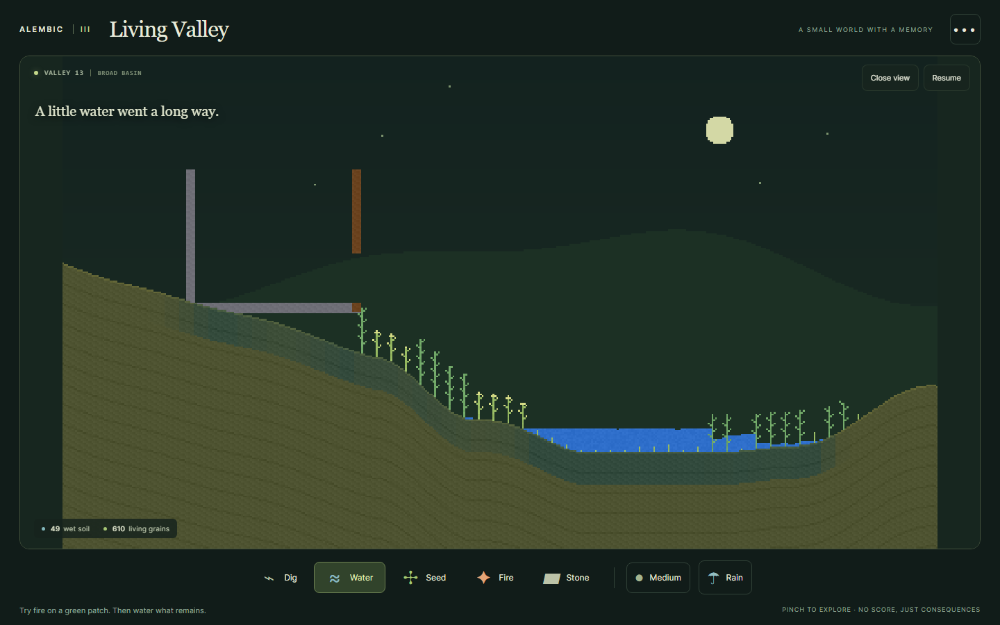
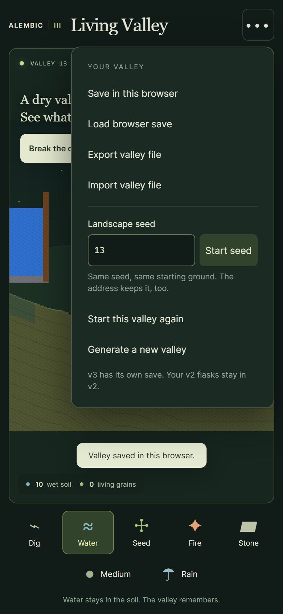

# Living Valley: main release verification, 2026-10-13

Alembic is `CosmonautJones/falling-sand`, verified from GitHub metadata, the repository README and local Codex history on TRAVTASTIC. Main before this release was `b11c88d63092e6cdf9a19deffa367cff5bcd3e8e`: TypeScript/Three.js v1 and a standalone worker-driven JavaScript v2. It had no Living Valley route. The experimental valley at `9f609ece2ceed841626cc943b71f9b62e5d04b25` had a fixed basin with small seeded surface variation; that experimental stack was not merged.

The bounded release adds a separate Living Valley page using the existing v2 grain engine, with retained moisture, finite nutrient budgets, plants, shade and fire memory. Its terrain generator offers broad basins, twin hollows and stone terraces with seeded depth, width and rim variation. A decimal seed field and versioned URL preserve reproducible starts. Terrain and ecological state are saved together. Equal seeds with equal generator versions reproduce starts; interactions still affect the outcome. No claim is made that every possible playthrough is unique.

## Scope and acceptance

The main-based product commit is `7d5370e0dc349b68fc65928d8dbce4d9ffd5e237`. It selectively integrates v3 from the validated quality checkpoint `271f2254fd3c145d94efce49aa58aa59c2789b0f`. The only main engine edit adds opt-in managed vegetation and ambient ember guards; native defaults preserve their original RNG consumption. V1/v2 pages, dependencies, checkpoint formats and controls remain available. Thermal/scent performance experiments, camera changes and Pop-the-Dam are excluded. The v2 phone Options / Version menu links to Living Valley; desktop users can use the direct v3 URL.

Acceptance was defined before editing: repeatable starts; bounded, coherent landforms with materially different flood habitats; atomic invalid input/import recovery; accurate reset and old-save replay; preserved keyboard/touch interaction; no viewport overflow; existing simulation tests and defaults preserved; and a browser-rendered demonstration. This release does not attempt a framework rewrite or promise physical-phone performance.

## Results

- All local applicable checks passed on the main product commit: 168 v1 tests, 172 v2 tests and 37 v3 tests (377 total), lint, typecheck and production build. Checks ran sequentially with one worker to avoid competing with other machine work. The existing 552.45 kB v1 bundle-size advisory remains.
- Exact-head GitHub check run [38330775801](https://github.com/CosmonautJones/falling-sand/actions/runs/38330775801) passed npm ci, lint, typecheck, v1, v2, v3 and build on that product SHA. The subsequent evidence-only commit receives its own CI before merge.
- [Native-default A/B evidence](evidence/2026-10-13-main-defaults.json) matches unchanged main in all 16 cases: five representative scenes across three seeds for 240 ticks, complete state hashes every 60 ticks, plus an edit/load/wipe sequence checked every tick. This is a bounded regression check, not a proof of all possible interactions.
- Terrain tests sampled 256 seeds, reproduced every profile, exercised all three landforms and required more than 240 distinct surfaces. Adjacent height changes stay at most four cells, with a connected outfall and a retaining right rim. Three representative landforms conserve soil nutrients and create different post-flood moisture distributions.
- Checkpoint continuation, real fire/regrowth, invalid nested state, legacy generator replay and repeat-random-draw recovery pass. A normalized original seed-12 starting checkpoint retains SHA256 `cef1027e9dfddd4b4b7d0b28c57d87c005ec34cdb71f12899a672a0dd1db668a`.
- [Browser acceptance](evidence/2026-10-13-seeded-browser.json) passed at desktop 1440x900, portrait 390x844, small portrait 320x680 and landscape 844x390 in Chromium 145.0.7632.6. It covered invalid/repeated/boundary seeds, keyboard painting, save/load/export, atomic invalid-file recovery, an evolved original v1 file, exact original reset, different-seed upgrade, repeated random draws and legacy bare seed links. Touch contexts additionally passed pinch without painting and rotation preservation. A [focused input proof](evidence/2026-10-13-input-proof.json) asserts that keyboard water changes the paused grain state at all four sizes, and that touch pinch increases rendered world width while preserving the exact saved world. No page errors or horizontal/vertical overflow were recorded.
- Each live flood case reached 49 wet-soil cells and 610 living grains after approximately 10.5 seconds. The exact frame-driven tick counts differ slightly between runs (636-644); deterministic state is asserted at fixed simulation ticks in the simulation tests.
- [Runtime sample](evidence/2026-10-13-render-runtime.json): one 179-frame RAF sample during flooding at each of desktop and portrait sizes on TRAVTASTIC, no CPU throttle. Both measured p50/p95 about 16.7 ms and p99 about 16.8 ms. These measure current simulation, rendering and browser/host scheduling together. They are not engine-only timings, a before/after speedup, sustained-load evidence or physical-phone results.
- A separate read-only reviewer inspected the main diff, tests, A/B harness and evidence. No actionable product or preservation findings remained. An earlier finding was fixed: typing a different seed after importing an old save now selects the new generator, while replaying the same old seed preserves its original ground.

## Visual evidence

The desktop flood visibly follows the landform, retains moisture and funds new growth. The seed menu is readable and operable on the smallest tested viewport; landscape menus scroll. Captures use reduced motion and phone device scale 2.

Additional desktop, portrait, 320px and landscape captures are in [images](images/).

## Limitations and next step

This is a polished first procedural/ecology slice, not a complete indie game production pass. Physical iOS/Android devices, accessibility assistive technologies and long mobile sessions still need manual testing. The world engine's raw checkpoints do not encode runtime managed/native options; the v3 outer save is sound because it always reconstructs the same managed/no-ambient-ember mode. Generic cross-mode raw world restores are outside the supported v3 save flow.

The existing main-to-Pages workflow is explicitly authorized for this release. Future staging can start with a versioned `/staging/<commit>/` path under existing Pages and a separate save-storage key; this release creates no staging workflow, new host or paid service.

